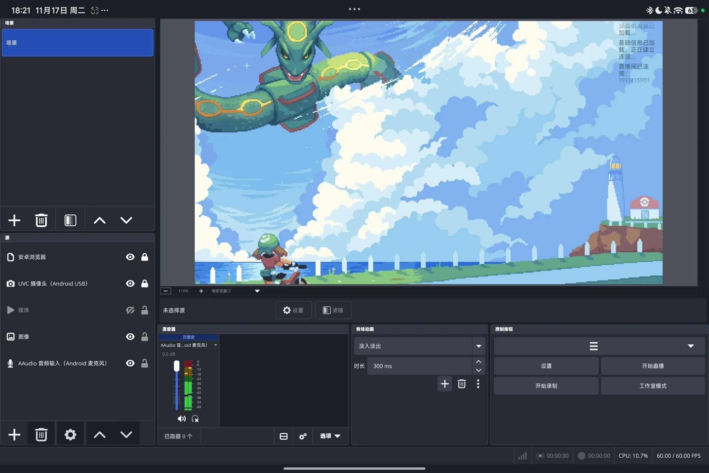
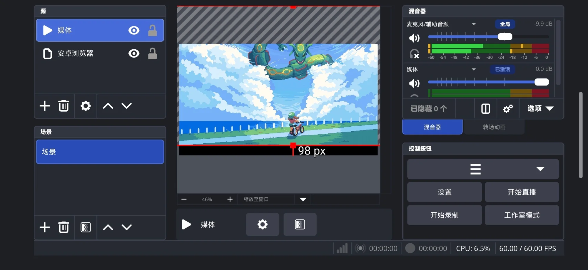

<div align="center">

  <p align="center">
    <a href="https://obsproject.com" target="_blank" rel="noopener noreferrer">
      
    </a>
    &nbsp;&nbsp;&nbsp;&nbsp;&nbsp;&nbsp;
    <a href="https://www.android.com" target="_blank" rel="noopener noreferrer">
      
    </a>
  </p>

  <h1>OBS for Android</h1>

  <p>
    <b>Android 平台直播推流与本地录制工具</b><br />
    <sub>基于 OBS Studio 33 · MediaCodec 硬件加速 · OpenGL ES · 自适应横屏交互</sub>
  </p>

  <p>
    <a href="https://github.com/Keee7/OBS-for-Android/releases"></a>
    <a href="https://github.com/Keee7/OBS-for-Android/actions/workflows/build-apk.yml"></a>
    
    
    
    <a href="LICENSE"></a>
  </p>

  <p>
    <a href="README.md"><b>English</b></a> &nbsp;•&nbsp;
    <a href="README_CN.md"><b>简体中文</b></a> &nbsp;•&nbsp;
    <a href="https://github.com/Keee7/OBS-for-Android/releases"><b>下载安装包</b></a>
  </p>

</div>

---

社区维护的 [OBS Studio](https://github.com/obsproject/obs-studio)（`v33` 基线）Android 移植版本，基于 [cunminF/OBS_for_Android](https://github.com/cunminF/OBS_for_Android) 构建。为 Android 手机与平板提供完整的场景合成、多源硬件采集、本地 Hybrid MP4/MOV 录制与直播推流工作流。

## 界面预览

<div align="center">

<p><b>平板模式</b> — 完整多停靠栏工作区</p>



<br /><br />

<p><b>手机横屏</b> — 自适应紧凑布局</p>



</div>

## 核心特性

### 视频管线、HDR 与编码

| 模块 | 能力摘要 |
| --- | --- |
| **MediaCodec 硬件编码** | 支持 H.264、HEVC（Android 13+ HDR 下支持 Main10）、AV1（推流与 Hybrid MP4）及 VP9（Hybrid MP4），采用零拷贝 Surface 输入，支持 `CBR` / `VBR` / `CQ`。 |
| **全色彩范围与智能回退** | 支持按色彩空间与码率模式探测 `常规 (Limited)` / `扩展 (Full)` 色彩范围；硬件不支持时自动衔接 ByteBuffer YUV（`NV12` / `I420`）或软件编码器并映射码率参数。 |
| **软件编码器** | 内置 `obs_x264`、`ffmpeg_x265`（`3.6`，8/10-bit）与 `ffmpeg_aom_av1`（`3.10.0`）。 |
| **10-bit HDR 管线** | 支持 Rec. 2100 PQ/HLG 合成、`P010` 硬件编解码与 `I010` 软编路径，并在 Hybrid MP4 中保留完整 HDR 元数据。 |

### 采集、音频与媒体拉流

| 模块 | 能力摘要 |
| --- | --- |
| **屏幕与单应用采集** | MediaProjection GPU 零拷贝采集（`SurfaceTexture`/OES，可选 CPU 回退），支持 Android 14+ 单应用窗口尺寸自适应及直通/预乘 Alpha 透明合成。 |
| **WebView 浏览器源** | 基于系统 WebView 的 GPU 纹理采集，支持透明背景弹幕叠加、网页/本地 HTML、自定义 CSS、触摸交互及“通过 OBS 控制音频”。 |
| **USB 与相机采集** | 双后端 USB UVC 采集（内置原生 + Android 加固版 `libuvc 0.0.9`；支持 `YUYV`、`UYVY`、`NV12`、`P010`、`RGB24`、`BGR24`、`MJPEG`、大载荷 Bulk 相机、自动匹配 UAC 音频与断流重连）、内置 Camera2 NDK 与 Nikon Z 系列 PTP 实时取景。 |
| **NDI® 局域网收发（BYOR）** | 原生 NDI® 输入源（`NsdManager` 自动发现与手动 IP）与主程序 NDI® 输出，支持应用内安全导入官方 Android `libndi.so`。 |
| **媒体与网络拉流** | FFmpeg MediaCodec 硬件解码（`H.264`、`HEVC`、`VP8`、`VP9`、`AV1`，失败自动软解）；支持文档 URI 与 `HTTP(S)`、`HLS`、`DASH`、`RTSP(S)`、`RTMP(S)`、`SRT`、`RIST`、`UDP`/`RTP`/`TCP` 流。 |
| **AAudio 音频输入** | 原生低延迟 AAudio 引擎，适配机身麦克风、有线耳机与 USB 声卡/采集卡伴音输入。 |

### Android 适配与渲染性能

| 模块 | 能力摘要 |
| --- | --- |
| **手机 / 平板自适应界面** | 基于 Qt `6.12` 的响应式布局（逻辑宽高 `< 952×552` 自动切换手机紧凑模式，大屏展开完整工作区），适配分屏、自由小窗与软键盘输入。 |
| **高性能局部脏区合成** | Android RHI BackingStore 局部脏区合并上传配合快照化 `VolumeMeter` / `MediaControls` / `AbsoluteSlider` 局部重绘，显著降低空闲与高亮场景的 CPU 占用与掉帧率。 |
| **共享存储录制** | 通过 MediaStore / SAF 文件描述符桥接，直接将 Hybrid MP4/MOV 写入 `Movies/OBS` 或 `Download/obs` 等公共目录。 |

## 运行环境

* **目标架构与系统**：`arm64-v8a`，Android 10+（API 29+），目标 API 35（编译 API 36）。
* **运行依赖**：浏览器源依赖 Android 系统 WebView；硬件编码档位与 10-bit HDR 渲染目标取决于设备 SoC 与 GPU 驱动能力。

## 快速上手

1. **安装应用**：从 [Releases](https://github.com/Keee7/OBS-for-Android/releases) 下载 APK 并执行 `adb install -r path/to/obs-android.apk`，或参考 [BUILDING.md](BUILDING.md) 自行编译。
2. **推荐初始配置**：
   * **视频**：`1920×1080` @ `60 FPS`，`SDR BT.709`（启用 10-bit HDR 时，在 **设置 → 高级 → 视频** 选择 `Rec. 2100 (PQ)` 或 `Rec. 2100 (HLG)`，配合 `P010` + `MediaCodec HEVC Main10` 或 `I010` + `x265` / `libaom`）。
   * **输出**：推流选择 `Android MediaCodec H.264`（`CBR`）；录像建议 `Hybrid MP4`，保存至共享存储目录（如 `/storage/emulated/0/Movies/OBS` 或 `Download/obs`）。
3. **添加来源**：
   * 按需添加 **屏幕采集（MediaProjection）**、**UVC 摄像头（Android USB）**、**内置摄像头（Camera2）**、**Nikon Webcam（Z 系列）** 或 **安卓浏览器**。
   * 拉取网络流时，添加 **媒体源** 并取消勾选 **本地文件**，填入 `HTTP(S)`、`HLS`、`DASH`、`RTSP`、`RTMP`、`SRT` 或 `RIST` 地址（必要时在 **FFmpeg 选项** 中传入如 `rtsp_transport=tcp`）。

<details>
<summary><b>可选：通过 ADB Logcat 验证硬件编码状态</b></summary>

```sh
adb logcat -v threadtime -d -s 'OBS-MediaCodec:*'
```

确认日志输出 `event=started hardware=true software=false input=Surface`、`event=first-packet headers=valid keyframe=1`，且 `event=summary` / `event=progress` 帧数与字节计数正常增长。

</details>

## 已知限制

* **HDR / 10-bit**：依赖 GPU 对 16-bit 归一化纹理与浮点渲染目标的支持；界面预览与 Android 屏幕采集仍按配置的 SDR 白电平以 SDR 混入场景，P010 USB 采集需采集卡硬件支持。
* **浏览器源**：暂不支持多指触控手势；跨域网页音频路由到 OBS 混音器需服务端支持 CORS。
* **推流服务**：Twitch / YouTube OAuth 快捷登录已禁用，请使用“自定义”服务手动填写 RTMP 服务器与推流码。

## 文档与开源许可

* **使用教程**：[docs/tutorial/README.md](docs/tutorial/README.md) — 安装权限、界面导览、音视频来源、推流录制、HDR/NDI 进阶与排查指南
* **构建指南**：[BUILDING.md](BUILDING.md) — GitHub Actions、Linux/WSL 与 Windows 构建说明
* **架构实现**：[IMPLEMENTATION_ANDROID.md](IMPLEMENTATION_ANDROID.md) — EGL/MediaCodec、MediaProjection、UVC、SAF 存储与 Qt 界面架构细节
* **参与贡献**：[CONTRIBUTING.md](CONTRIBUTING.md) — 问题反馈与贡献规范
* **开源声明**：[NOTICE.md](NOTICE.md) — 第三方依赖许可证与商标声明

本项目遵循 **GPL-2.0-or-later** 许可证（[LICENSE](LICENSE)），为社区维护的独立移植版本，与 OBS Project 无关。
