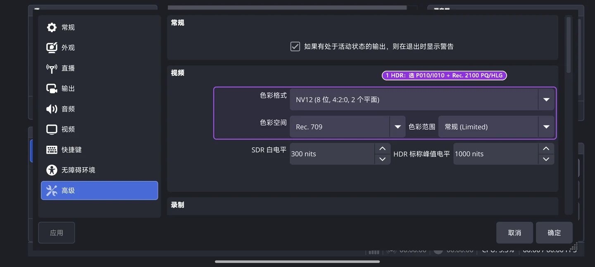

# HDR 与色彩空间

如果设备 GPU 支持 16-bit 归一化纹理与浮点渲染目标，OBS for Android 会自动解锁 **10-bit HDR 合成与编码管线**，在 Hybrid MP4 录像或支持 HDR 的推流中保留完整的亮度与广色域元数据。

## 1. 启用 10-bit HDR 的两条路径

打开 **设置 → 高级 → 视频**：

1. **色彩空间**：选择 **`Rec. 2100 (PQ)`**（HDR10 常用标准）或 **`Rec. 2100 (HLG)`**（混合对数伽马）。
2. **色彩格式**：选择后 OBS 会根据硬件能力自动配合或提示：

| 路线 | 色彩格式 | 输出编码器 | 适用条件与说明 |
| --- | --- | --- | --- |
| **10-bit 硬件管线（推荐）** | `P010` | **Android MediaCodec HEVC Main10** | 需 **Android 13+** 且 SoC 硬件支持 HEVC Main10；CPU 占用极低，适合 1080p60 HDR 实录。 |
| **10-bit 软件管线** | `I010` | **Software HEVC (x265)** 或 **Software AV1 (AOM)** | 设备不支持硬件 Main10 或旧系统时使用；CPU 负载高，建议降低分辨率或帧率录制。 |

3. **色彩范围**：HDR 下务必保持 **`常规 (Limited)`**（绝大多数手机硬件编码器不支持 Full 范围）。

## 2. SDR 白电平与混入说明

* **SDR 内容混入**：常规图片、浏览器弹幕、FreeType 文字以及 Android 屏幕采集（MediaProjection）本身输出的是 SDR 画面，合进 HDR 画布时会根据高级视频设置里的 **SDR 白电平**（默认 `300 nits`）自动做亮度映射。
* **界面预览**：主界面的预览窗仍按 SDR 显示输出色调，不影响最终写入 Hybrid MP4 录像文件的真实 10-bit HDR 亮度信息。
* **真 10-bit HDR 采集输入**：目前支持通过 `P010` 兼容的 USB 采集卡（需采集卡硬件支持 P010 输出）或 10-bit HDR 媒体源输入。
