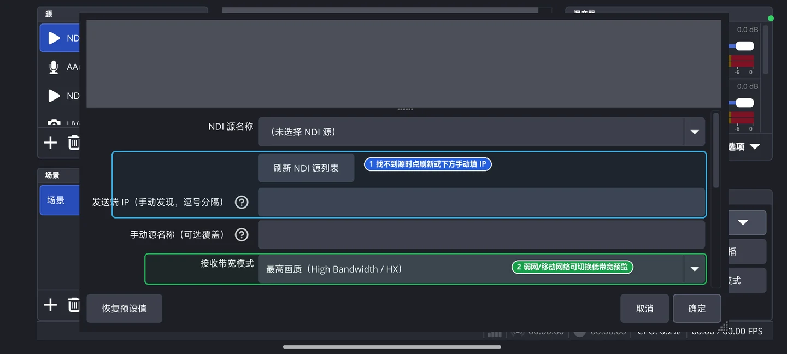

# NDI® 局域网收发与场景配方

## 1. NDI® 局域网音视频收发（BYOR）

通过 **NDI®**，你可以在同一局域网下无线拉取电脑/相机的画面，或把手机 OBS 的合成画面低延迟推给电脑导播台。

### 导入官方运行库 `libndi.so`

为遵循 GPLv2 与 NDI SDK 许可协议，公开版 APK 不内置闭源 `libndi.so`，需首次使用时自行从官方下载导入：

1. 在 OBS 主界面点击 `☰` → **工具(T) → NDI® 设置…**（入口见 [界面导览](../quick-start/interface-overview.md)）。
2. 点击 **官方下载页**，从 `ndi.video` 下载 **NDI SDK for Android**（`.tar.gz`、`.sh` 或解压其中的 `arm64-v8a/libndi.so`）。
3. 点击 **导入官方 NDI SDK / libndi.so…** 并选中文件，OBS 会自动校验 ARM64 架构、16 KB 页对齐与全部必需符号，提示导入成功后即可使用。

### 作为接收端（NDI® 输入源）

* 添加 **NDI® 输入源**，选择局域网设备名即可接收；若路由器拦截了 mDNS 组播或跨网段，在 **发送端 IP（手动发现，逗号分隔）** 中填写对方 IP（如 `192.168.1.50`）后点 **刷新 NDI 源列表**。
* Wi-Fi 带宽紧张时，可将 **接收带宽模式** 调为 **低带宽预览** 或 **仅音频**。

### 作为发送端（NDI® 主程序输出）

在 **NDI® 设置…** 对话框中勾选 **启用主程序 NDI® 输出（Program Output）**，设置易辨认的输出名称（默认 `OBS for Android`），电脑端 OBS 即可直接搜到这台手机画面。

---

## 2. 三套开箱即用场景配方

### 配方 A：手游单机直播 / 录屏

* **视频与输出**：`1920×1080 @ 60 FPS`，`Android MediaCodec H.264`（`5000 Kbps CBR`），录像 `Hybrid MP4`。
* **来源顺序（从上到下）**：
  1. **安卓浏览器**（弹幕机 URL + 透明背景）
  2. **AAudio 音频输入**（耳机解说 + RNNoise 降噪滤镜）
  3. **屏幕采集（MediaProjection）**（Android 14+ 推荐单应用共享，含系统内录）

### 配方 B：Switch / 相机 + UVC 采集卡户外直播

* **视频与输出**：`1080p60` 或弱网 `720p30`（`3000 Kbps`，开启「动态变更比特率」）。
* **来源配置**：**UVC 摄像头**（MJPEG 1080p60 或 YUYV + 最低延迟，音频选自动匹配）+ **AAudio**（外接无线麦，`unprocessed` 预设）+ 半透明 Logo 水印。

### 配方 C：平板轻量多机位导播台

* **核心编排**：主机位用 **UVC 采集卡 / Nikon Z 相机**，无线副机位用另一台手机通过 **NDI®** 无线回传，搭配本地 **媒体** 片头视频，全程开启 **工作室模式** 预监切换。
