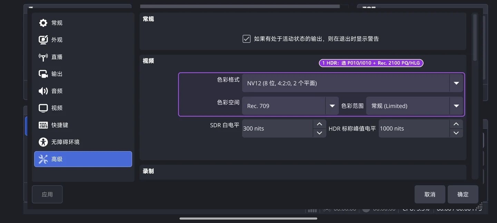

# HDR & Color Spaces

When your device GPU supports 16-bit normalized textures and floating-point render targets, OBS for Android unlocks a full **10-bit HDR compositing and encoding pipeline**, preserving PQ/HLG brightness and wide-color metadata in Hybrid MP4 recordings and HDR-ready outputs.

## 1. Two Paths for 10-bit HDR

Open **Settings → Advanced → Video**:

1. **Color Space**: Choose **`Rec. 2100 (PQ)`** (HDR10) or **`Rec. 2100 (HLG)`** (Hybrid Log-Gamma).
2. **Color Format**: Choose according to your hardware support:

| Path | Color Format | Output Encoder | Requirements & Notes |
| --- | --- | --- | --- |
| **10-bit Hardware (Recommended)** | `P010` | **Android MediaCodec HEVC Main10** | Requires **Android 13+** and SoC hardware Main10 support; low CPU overhead, ideal for `1080p60` HDR recording. |
| **10-bit Software** | `I010` | **Software HEVC (x265)** or **Software AV1 (AOM)** | Used when Main10 hardware is unavailable or on older OS releases; high CPU usage—lower resolution or FPS accordingly. |

3. **Color Range**: Keep **`Limited`** under HDR (most mobile hardware encoders reject Full-range inputs).

## 2. SDR White Level & Mixed Sources

* **Blending SDR Sources**: Standard images, Browser overlays, FreeType text, and Android Screen Capture (MediaProjection) produce SDR frames; OBS tone-maps them into the HDR canvas using **SDR White Level** (`300 nits` by default).
* **On-Screen Preview**: The app's preview canvas continues tone-mapped to SDR for screen viewing without affecting the true 10-bit HDR output written to disk.
* **True 10-bit HDR Ingest**: Supported via `P010`-capable USB UVC capture cards or 10-bit HDR Media Sources.
