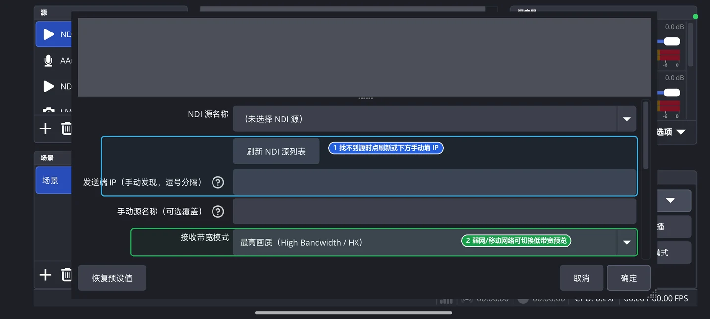

# NDI® LAN I/O & Scene Recipes

## 1. NDI® Local Network Audio/Video (BYOR)

Using **NDI®**, you can wirelessly ingest PC or secondary mobile camera feeds on the same LAN, or send your Android OBS composite to a desktop production switcher.

### Importing the Official `libndi.so` Library

To comply with both GPLv2 and the NDI SDK license, prebuilt APKs do not bundle proprietary `libndi.so`. Import it once when needed:

1. Tap `☰` → **Tools (T) → NDI® Settings…** (see [Interface Overview](../quick-start/interface-overview.md)).
2. Open the **Official Download Page** link for **NDI SDK for Android** from `ndi.video` (`.tar.gz`, `.sh`, or extracted `arm64-v8a/libndi.so`).
3. Tap **Import Official NDI SDK / libndi.so…** and select the archive or `.so`. OBS validates ARM64 ABI, 16 KB page alignment, and required symbols automatically.

### Receiving (`NDI® Input Source`)

* Add an **NDI® Input Source** and pick a discovered LAN sender. If your router blocks mDNS multicast or spans subnets, enter sender IPs under **Manual Discovery IPs (comma-separated)** (e.g., `192.168.1.50`) and tap **Refresh NDI Sources**.
* On congested Wi-Fi, switch **Bandwidth** to **Lowest** or **Audio Only**.

### Sending (`NDI® Program Output`)

Check **Enable Main NDI® Output (Program Output)** inside **NDI® Settings…** and assign a clear output name (defaults to `OBS for Android`) so desktop OBS can receive your feed over Wi-Fi/Ethernet.

---

## 2. Three Ready-to-Use Scene Recipes

### Recipe A: Solo Mobile Gaming Stream / Recording

* **Video & Output**: `1920×1080 @ 60 FPS`, `Android MediaCodec H.264` (`5000 Kbps CBR`), **Hybrid MP4**.
* **Layer Stack (Top to Bottom)**:
  1. **Android Browser** (chat overlay URL + Transparent background)
  2. **AAudio Audio Input** (headset mic + `RNNoise` filter)
  3. **Screen Capture (MediaProjection)** (Android 14+ single-app sharing with internal audio)

### Recipe B: Console / Mirrorless Camera + UVC Capture Card IRL

* **Video & Output**: `1080p60` (or `720p30` at `3000 Kbps` with **Dynamically change bitrate** enabled outdoors).
* **Sources**: **UVC Camera** (`MJPEG 1080p60` or `YUYV` + Lowest Latency, UAC audio on Auto Match) + **AAudio** (wireless lav mic, `unprocessed` preset) + transparent corner logo.

### Recipe C: Tablet Multi-Cam Production Switcher

* **Setup**: Main camera over **UVC Capture Card / Nikon Z**, wireless B-cam from a second phone via **NDI®**, local **Media Source** intro bumper, operated with **Studio Mode** active.
