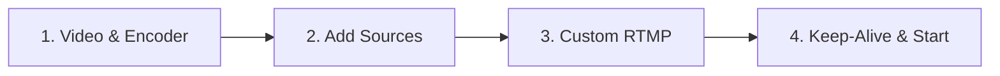
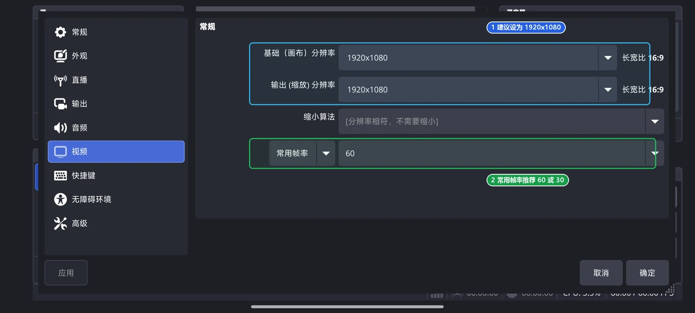
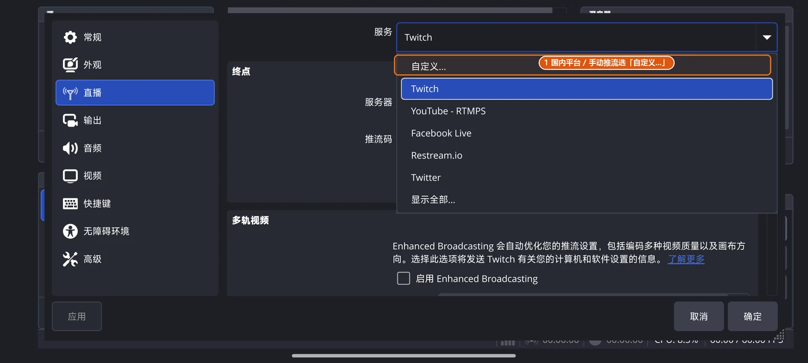

# Your First Stream

Follow these 4 steps to go live (or run a test local recording) in about 5 minutes.

## Step 1: Configure Video & Hardware Encoding

1. Open **Settings → Video**:
   * Set both **Base (Canvas) Resolution** and **Output (Scaled) Resolution** to `1920x1080` (choose `1280x720` if upload bandwidth is limited or to keep temperatures lower).
   * Set **Common FPS Values** to `60` for gaming or `30` for IRL/outdoor streams.
2. Switch to **Settings → Output** (keep **Output Mode: Simple**):
   * **Video Encoder**: Pick **`Android MediaCodec H.264`** (zero-copy hardware encoding, cool and efficient).
   * **Video Bitrate**: `4500–6000 Kbps` for `1080p60`, or `2500–3500 Kbps` for `720p30`.
   * **Audio Bitrate**: Leave at `160`.

## Step 2: Add Capture Sources

Back on the main screen, tap **`+`** at the bottom of **Sources**:
* **Mobile Gaming**: Add **Screen Capture (MediaProjection)** (includes internal system audio), then optionally add **AAudio Audio Input** (headset mic) and **Android Browser** (transparent chat overlay).
* **Facecam / IRL**: Add **Built-in Camera (Camera2)** and **AAudio Audio Input**.
* **External HDMI Capture Card**: Add **UVC Camera (Android USB)**.

Arrange layers in the preview canvas and speak or play audio to verify the green/yellow bars jump in the **Audio Mixer**.

## Step 3: Enter Your RTMP Server & Stream Key

1. Open **Settings → Stream**.
2. Set **Service** to **`Custom...`**.
3. Paste the **Server** (`rtmp://...` or `rtmps://...`) and **Stream Key** from your streaming platform's creator dashboard, then tap **OK**.

## Step 4: Enable Keep-Alive & Go Live

1. Confirm OBS has **Notification** permission enabled and is excluded from aggressive battery optimization in Android settings (see [Background Keep-Alive Guide](../streaming-and-recording/background-keepalive.md)).
2. Tap **Start Streaming** in Controls. Once the bottom status bar shows a green connection indicator and an incrementing timer, you are live!
