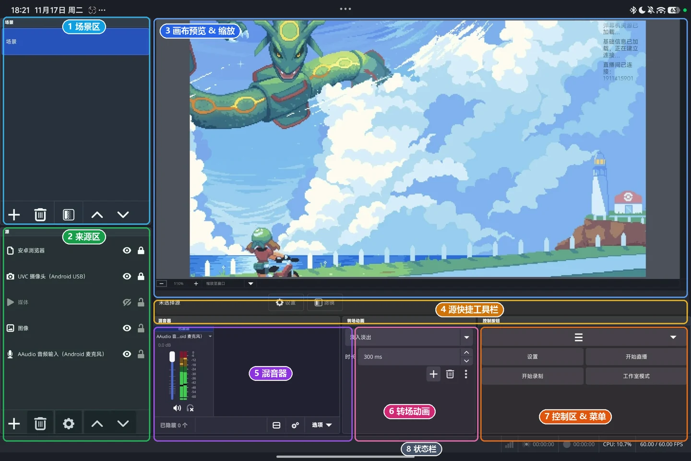
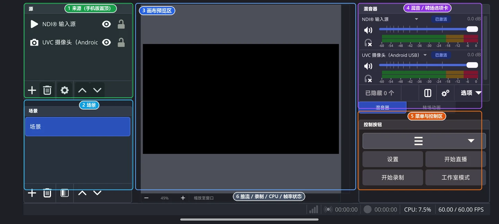
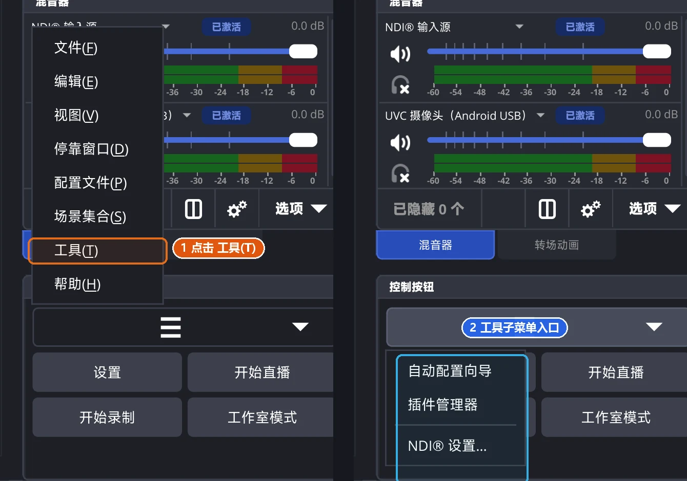

# Interface Overview & Touch Controls

OBS for Android automatically switches between two UI layouts based on available logical dimensions: when logical width is `< 952` or height is `< 552`, it switches to **Phone Compact Mode**; with ample screen space, it expands into the **Tablet Full Workspace**. *(Note: annotated callout screenshots show Chinese UI labels with matching numbered regions below.)*

## 1. Tablet Full Workspace

1. **Scenes**: Switch between prearranged layouts (such as "Gameplay", "BRB", or "Facecam Only").
2. **Sources**: Manage layers inside the current scene, stacked **top-to-bottom** (higher items draw over lower items). Toggle the eye icon to show/hide or the lock icon to prevent accidental drags.
3. **Canvas Preview & Zoom**: View the live composite in real time and use `- / +` at the bottom to inspect details (keeping **Scale to Window** is recommended for daily use).
4. **Context Toolbar**: Select a source to reveal quick buttons for **Properties** and **Filters**; interactive sources (like Android Browser) also display **Interact**.
5. **Audio Mixer**: Live level meters, mute toggles, and Advanced Audio Properties.
6. **Scene Transitions**: Choose transition style and duration between scenes (defaults to **Fade 300 ms**).
7. **Controls & `☰` Menu**: Houses the `☰` main menu, **Settings**, **Start Streaming**, **Start Recording**, and **Studio Mode**; when a Built-in Camera is in the top-level scene, a quick **Flip Camera** button appears automatically.
8. **Status Bar**: Shows active stream/recording timers, CPU usage, and current FPS.

## 2. Phone Compact Mode

On smaller screens, the layout adapts for one-handed or quick touch control:
* **Sources above Scenes**: Frequently toggled layer controls sit at the top-left.
* **Tabbed Audio Mixer & Transitions**: Merged into a tab switcher at the bottom so the center preview keeps maximum space.
* **Auto-Hiding Context Toolbar**: Collapses when no source is selected and appears cleanly once you tap a source.
* **Two-Column Controls**: Prevents vertical crowding and stays usable inside split-screen or Freeform windows.

## 3. The `☰` Hamburger Menu

All top-level desktop menus live inside the `☰` button in Controls:

* **File (F)**: Open recordings folder, exit app, etc.
* **Profile (P) / Scene Collection (S)**: Create, switch, or export/import backups through the Android system file picker.
* **Tools (T)**: Open **Auto-Configuration Wizard**, **Plugin Manager**, and **NDI® Settings…**.
* **Help (H)**: View or export **Log Files**, **Check for Updates**, and view **About** info.

## 4. Touch Control Tips

* **Drag & Lock**: Tap and drag an item directly in the preview canvas to move or resize via corner handles; enable the lock icon beside finalized layers to prevent accidental touches while live.
* **Keep Screen Awake**: Go to **Settings → General → Output** and check **Keep screen awake during streaming or recording** when monitoring OBS on screen.
