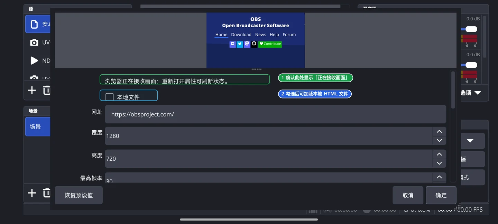

# Android Browser & Chat Overlays

**Android Browser** is powered by Android System WebView, rendering web pages via an isolated virtual display and zero-copy `AHardwareBuffer` textures—ideal for **transparent chat overlays, alert boxes, subscriber widgets, or local HTML animations**.

## 1. Key Settings

* **URL vs. Local File**: Uncheck **Local file** to enter any live chat or overlay URL; check **Local file** to pick a `.html` or `.xhtml` file from storage. Seeing **"Browser is receiving frames"** beneath the top thumbnail confirms active rendering.
* **Width / Height / Max FPS**: Size the source to match your widget (e.g., `1280×720` or `480×800` for a vertical chat column). Capping **Max FPS** at `30` saves battery for chat and static HUD widgets.
* **Transparent Background**:
  * Checking **Transparent background** switches the pipeline to `ImageReader (RGBA_8888)` + `EGLImage` so WebView alpha channels composite directly without needing a green-screen chroma key.
  * If a page hardcodes an opaque white or colored background, add `body { background-color: transparent !important; }` inside **Custom CSS**.
* **Alpha Handling**: If semi-transparent edges show dark fringes, toggle between **Compatible (Default)**, **Preserve Alpha (Straight)**, and **Preserve Alpha (Premultiplied)**.

## 2. Audio Control & Touch Interaction

* **Control audio via OBS**: Checking this reloads the page and routes WebView audio directly into the OBS **Audio Mixer** for independent volume and filter control. Note: cross-origin audio/video elements require the remote server to send valid CORS headers.
* **Interact with Web Pages**: Select the Android Browser source and tap **Interact** on the quick toolbar to scroll, log in, or tap buttons using a single finger inside the interaction modal (multi-touch pinch zoom is not currently supported).
