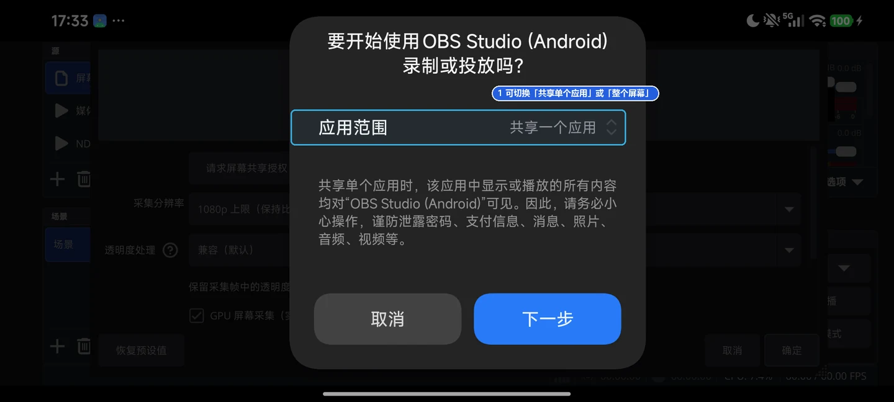
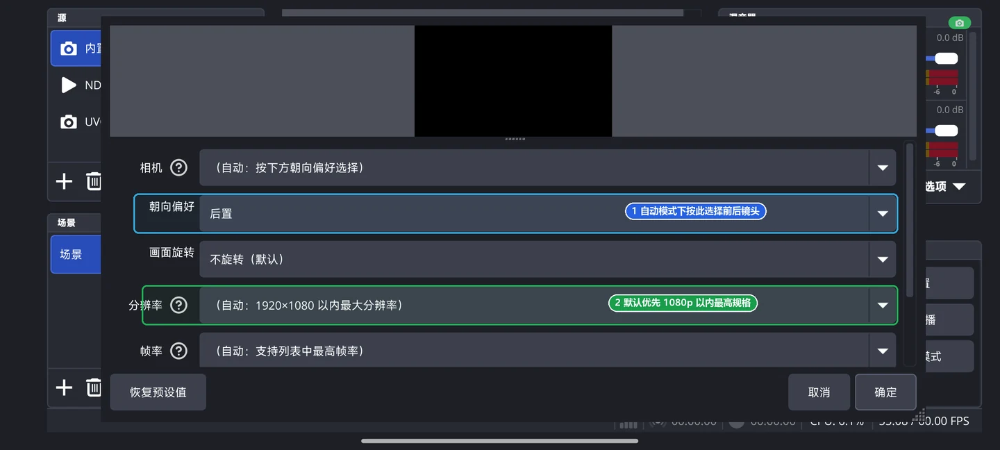

# Camera & Screen Capture

This guide covers the three core built-in capture inputs on Android: **Screen Capture (MediaProjection)**, **Built-in Camera (Camera2)**, and **Nikon Webcam (Z Series)**.

## 1. Screen Capture (MediaProjection)

Ideal for mobile gaming streams and app demos, with built-in internal system audio capture.

* **Single App vs. Entire Screen**: On Android 14 and later, the system consent prompt lets you choose **Share one app** or **Share entire screen**. Sharing a single app keeps your launcher, notifications, and private messages hidden when switching apps, and OBS automatically adapts to orientation or window-size changes.
* **Capture Resolution**: Keeping **`1080p cap (keep aspect, reduce memory bandwidth)`** is recommended. Avoid native 2K/1.5K capture unless extra sharpness is essential, as it significantly raises GPU memory bandwidth.
* **GPU Screen Capture (Experimental)**: Enabled by default for zero-copy `SurfaceTexture` / OES rendering. Only uncheck to fall back to CPU capture if a specific device exhibits visual corruption or black frames.
* **Alpha / Transparency Handling**: Keep **Compatible (Default)** for normal displays; choose **Preserve Alpha (Straight)** or **Preserve Alpha (Premultiplied)** if capturing transparent floating widgets or overlays.
* **System Audio**: MediaProjection attaches internal system audio automatically, displaying live sample rate and peak meters at the bottom of the source properties.

## 2. Built-in Camera (Camera2)

* **Camera & Facing Preference**: Leave **Camera** on `Auto` and select **Front** or **Back** under **Facing Preference**.
* **One-Tap Flip Camera**: Whenever a Built-in Camera source sits in the active top-level scene, Controls reveals a **Flip Camera** shortcut button to toggle front/rear lenses instantly.
* **Resolution & FPS**: `Auto` chooses the highest spec up to `1920×1080` and the highest peak FPS (preferring fixed-FPS ranges when tied). In low light, drop manually to `1280×720` or fixed `30 fps` to avoid frame drops.
* **Rotation & Color Matrix**: Correct orientation using **Rotation** (90°/180°/270°), or switch between `Rec. 709` and `Rec. 601` if skin tones look shifted.
* **Background Policy**: Android requires apps to release camera hardware when backgrounded. OBS pauses the camera session automatically and resumes cleanly when you return to the foreground.

## 3. Nikon Webcam (Z Series Direct USB)

With a Nikon Z-series mirrorless camera, a single USB cable brings live view directly into OBS without an HDMI capture card:

1. Set the camera's USB mode to **MTP/PTP** and connect it to your phone or tablet.
2. Add **Nikon Webcam (Z Series)**, tap **Request USB Permission**, and confirm the Android USB prompt.
3. **Live View Resolution** supports `QVGA 320×240`, `VGA 640×480`, and `XGA 1024×768 (default cap)`, with **JPEG Quality (0–5)** to balance sharpness and USB bandwidth.
4. If OBS warns that the camera refused Live View, make sure the camera is not in menus/playback, has sufficient battery, is not overheating, and is not recording internally.
