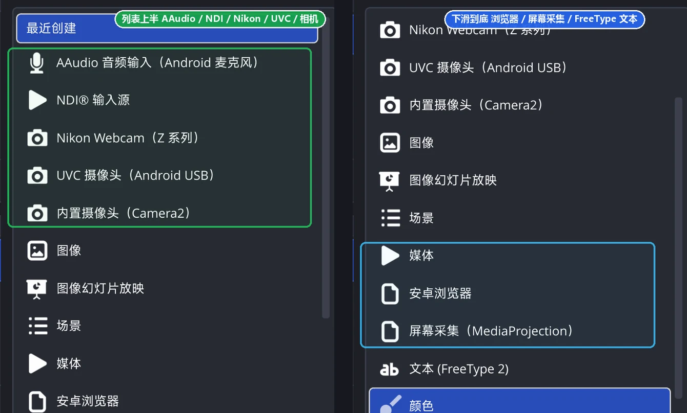
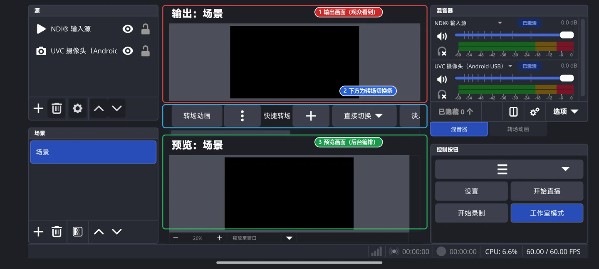

# Scene Management

OBS organizes compositions using **Scenes** and **Sources**. You can prepare multiple scenes in advance (for example, "Main Gameplay", "Facecam Break", and "Starting Soon") and switch cleanly with a single tap while live.

## 1. Adding & Layering Sources

Tap `+` at the bottom of **Sources** to add elements. The list renders **top-to-bottom**:
* Place background images or full-screen gameplay at the bottom;
* Place picture-in-picture cameras, FreeType 2 text titles, and **Android Browser** transparent overlays near the top.
* Use the eye icon on the right to temporarily toggle visibility, and the lock icon to prevent accidental movement on a touchscreen.

## 2. Studio Mode (Preview Before Going Live)

Tap **Studio Mode** in Controls to split the workspace into **Program (top)** and **Preview (bottom)**:

* **Top (Program)**: What viewers or your recording file are currently receiving.
* **Bottom (Preview)**: Your offline staging area. Adjust positions, toggle layers, or cue up the next scene privately, then tap **Transition** or drag the T-bar slider in the middle to take it live.

## 3. Transitions, Filters & Scene Collections

* **Scene Transitions**: Supports Fade (300 ms default), Slide, Swipe, Luma Wipe, and Stinger transitions. In Phone Compact Mode, access them from the **Scene Transitions** tab at the bottom-right.
* **Video Filters**: Select a source and tap **Filters** on the quick toolbar to add **Color Correction**, **Crop/Pad**, **Scaling/Aspect Ratio**, **Chroma Key**, and more.
* **Export / Import Scene Collections**: Open `☰` → **Scene Collection (S)** (or **Profile (P)**) to export/import backups via the Android system file picker before switching devices or reinstalling.
