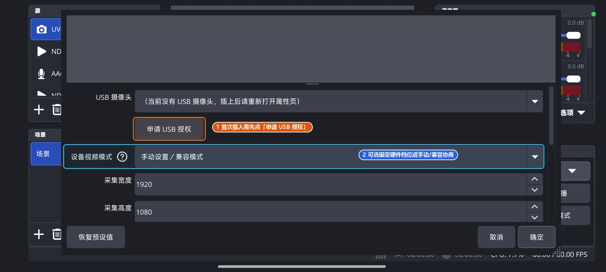

# USB/UVC Capture Cards

Using **UVC Camera (Android USB)**, you can feed HDMI video from a Nintendo Switch, PS5, mirrorless/DSLR camera, or PC into your Android phone or tablet via a USB capture card, or attach external USB webcams.

## 1. Connection & USB Permission

1. Use a **USB 3.0 hub with Power Delivery (PD)** or a short direct cable so long broadcasts don't drain your battery or drop power on the capture card.
2. Add **UVC Camera (Android USB)** and open **Properties**. If the device dropdown displays `(unauthorized)`, tap **Request USB Permission** and allow the system dialog.

## 2. Video Modes & Formats

* **Device Video Mode**:
  * **Hardware Capability Preset** (e.g., `MJPEG 1920×1080 · 60 FPS`): Locks directly onto an exact descriptor reported by the capture card—most reliable.
  * **Manual / Compatibility Mode**: Lets OBS negotiate resolution, FPS, and format from your entered fields.
* **Choosing a Video Format**:
  * **`MJPEG`**: Low USB bandwidth demand, works at `1080p60` even over USB 2.0 cables, widest compatibility.
  * **`YUYV` / `NV12` / `RGB24` / `BGR24`**: Uncompressed raw video with crisper text and zero JPEG artifacts, requiring a solid **USB 3.0** connection.
* **Low Latency & YUV Locking**:
  * **Lock selected YUV format (disable fallback)**: Enable with `YUYV`, `NV12`, or `P010` to prevent silent fallback to MJPEG and turn on USB bandwidth pre-checks.
  * **Lowest latency (latest frame)**: Recommended for action or rhythm games on console (requires YUV lock enabled); drops queued older frames in favor of the freshest frame.

## 3. UAC Audio Matching & Auto-Reconnect

* **Audio Input**: Default **Auto Match** binds the capture card's companion UAC USB audio interface by USB topology path and `VID:PID` (requires Microphone permission). You can also pick a specific device manually or choose System Default.
* **Disconnect Watchdog**: OBS uses a ring-buffer ingest pipeline decoupled from `libusb` event threads plus a stall watchdog—loose cables, hot-plugs, or stalled endpoints automatically clear pipes and attempt reconnection.

> [!NOTE]
> For cable specifications, capture card tiers, and kernel `uvcvideo` conflict notes, see [Capture Card Compatibility](../compatibility/capture-card-compatibility.md).
