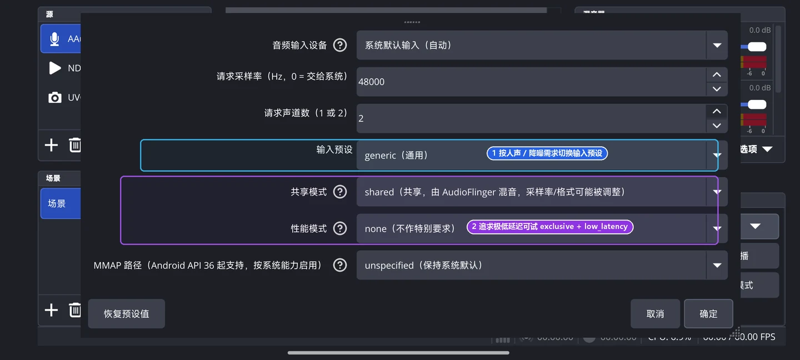

# Audio Settings

OBS for Android captures microphones, headsets, and USB audio interfaces via native low-latency **AAudio**, and encodes output audio with FFmpeg AAC (`ffmpeg_aac`).

## 1. Global Audio Settings

Open **Settings → Audio**:
* **Sample Rate**: Keep **`48 kHz`**.
* **Channels**: **`Stereo`**.
* **Global Audio Devices**: Keeping these **Disabled** and adding **AAudio Audio Input** sources per scene gives cleaner control across scene switches.

## 2. Adding AAudio Audio Input (Android Microphone)

* **Audio Input Device**:
  * Use **System Default Input (Auto)** for everyday wired headsets or Bluetooth mics.
  * When attaching dedicated USB audio interfaces, select the specific device manually; even if Android reassigns device IDs after replugging, OBS attempts to re-match by product name.
* **Input Preset**:
  * `generic`: Balanced default for most mics.
  * `voice_communication`: Applies Android's built-in echo cancellation—great for voice chat or speakerphone setups.
  * `unprocessed`: Disables system AGC/noise suppression—recommended for external USB interfaces and condenser mics to keep vocals natural.
* **Sharing Mode & Performance Mode**: With capable USB interfaces, try **`exclusive` + `low_latency`**. If the device HAL rejects exclusive access, the plugin automatically falls back to `shared` mode so audio never cuts out.
* **MMAP Path**: Active only on **Android API 36+** when supported by HAL; safely ignored on older OS releases.

## 3. Audio Mixer & Noise Suppression

In the **Audio Mixer**, adjust faders so speech or game audio peaks inside the green-to-yellow zone (`-18 dB` to `-6 dB`) without clipping into `0 dB` red.

Tap the gear icon beside an audio source → **Filters** to add built-in audio processing:
* **Noise Suppression**: Choose `RNNoise` (high-quality AI speech isolation) or `Speex` (minimal CPU) to suppress fan hum or room noise.
* **Gain / Compressor**: Boost quiet voices or prevent shouting from clipping.
* **Advanced Audio Properties**: Enable **Audio Monitoring** or route sources to independent audio tracks (e.g., Track 1 mixed for stream, Track 2 isolated mic for editing).
