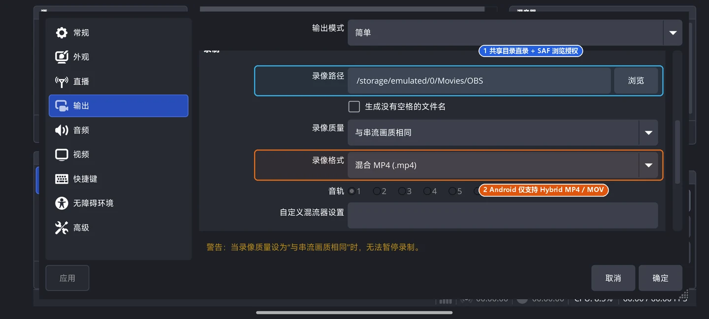

# Local Recording

OBS for Android writes recordings straight into shared storage through **MediaStore / SAF (Storage Access Framework)** using seekable file descriptors—requiring **no "All files access" permission** and **zero private temporary copies**.

## 1. Recording Path

* **Default Folder**: `/storage/emulated/0/Movies/OBS` (visible under `Movies/OBS` in your file manager and automatically indexed in your gallery).
* **Custom Shared Folder (SAF)**: To save to `Download/obs` or external storage, tap **Browse** beside Recording Path, select the folder in Android's file picker, and confirm access to persist permission.

## 2. Recording Formats (Why Hybrid MP4 / MOV Only)

Under **Settings → Output → Recording → Recording Format**, Android offers two native formats:
* **`Hybrid MP4 (.mp4)`** (Recommended)
* **`Hybrid MOV (.mov)`**

> [!NOTE]
> Desktop formats such as `mkv`, `flv`, `ts`, and Custom FFmpeg Output rely on an external `ffmpeg-mux` subprocess. Because Android sandboxing forbids `fork+exec` subprocess muxing, those options are hidden on Android. **Hybrid MP4 / MOV** runs inside the `obs-outputs` process directly, combining standard MP4 player compatibility with **crash and power-loss resilience**—even if your phone shuts off mid-recording, footage written up to that moment remains playable.

## 3. Recording Quality & Pausing

* **Same as stream**: Saves an exact local copy while streaming with zero extra encoding cost (**pause is unavailable** in this mode).
* **High Quality, Medium File Size** (`8 Mbps CBR` under MediaCodec) or **Indistinguishable Quality, Large File Size** (`12 Mbps CBR`): Best for standalone recordings and supports pausing/resuming mid-recording.
* **Auto-Record While Streaming**: Enable **Automatically record when streaming** under **Settings → General → Output**.
