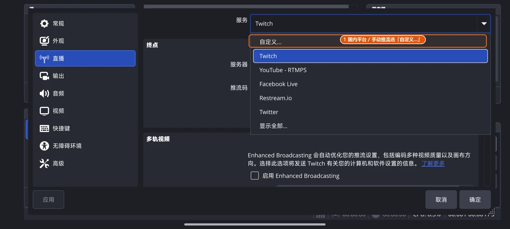

# RTMP / SRT Streaming & Protocols

On Android, **outbound streaming** and **inbound Media Source playback** support different sets of network protocols:

| Direction | Supported Protocols | Notes |
| --- | --- | --- |
| **Live Streaming (`Settings → Stream`)** | `RTMP` / `RTMPS` (plus LAN `NDI®`) | Powered by native `obs-outputs` + MbedTLS; supports H.264 / HEVC / AV1 over RTMP in Advanced output mode. |
| **Media Pull (Media Source)** | `SRT`, `RIST`, `RTSP(S)`, `RTMP(S)`, `HLS`, `DASH`, `HTTP(S)` | Powered by built-in FFmpeg (`srt-1.5.4`, `librist`, `mbedtls`). See [Network Media Sources](../scenes-and-sources/network-media-source.md). |

> [!IMPORTANT]
> Because Android does not allow launching an external `obs-ffmpeg-mux` helper process, **outbound Live Streaming does not currently push to `srt://` or `rist://` destinations** (starting an output with `srt://` in Stream Settings will fail). For low-latency wireless handoff to a desktop switcher, use [NDI® Program Output](../advanced/ndi-and-recipes.md) or a local RTMP server instead.

## 1. Custom RTMP / RTMPS Stream Setup

Since OAuth platform logins (Twitch/YouTube) are disabled, all platforms share one straightforward manual flow:

1. Open **Settings → Stream**.
2. Set **Service** to **`Custom...`**.
3. Copy your ingest details from your streaming platform:
   * **Server**: Enter `rtmp://...` or `rtmps://...`.
   * **Stream Key**: Paste the stream key (if your platform gives one combined URL, split at the last `/`).
4. If the endpoint requires login credentials, check **Use authentication** and fill in **Username** and **Password**.

## 2. Unstable Networks: Auto-Reconnect & Dynamic Bitrate

Check two vital protections under **Settings → Advanced → Network**:
* **Automatically reconnect**: Enabled by default (adjustable retry delay and max retries) to recover cleanly across Wi-Fi/5G handoffs or elevator dead zones.
* **Dynamically change bitrate to manage congestion**: Recommended for cellular outdoor streaming—temporarily lowers video bitrate when send buffers back up instead of dropping the stream.
