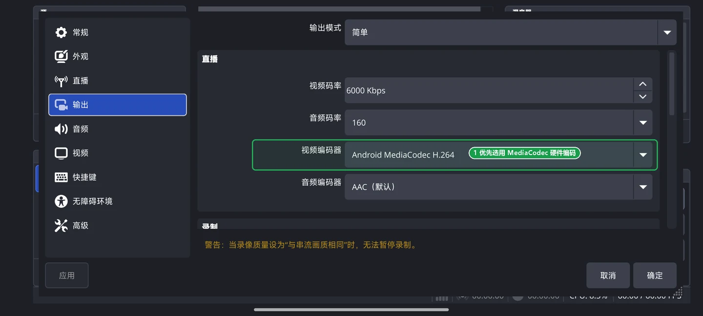

# Video Encoders

Open **Settings → Output** in either **Simple** or **Advanced** mode to select the encoder used for streaming and recording.

## 1. Encoder Comparison

**Android MediaCodec** hardware encoders appear at the top of the list, followed by built-in software encoders:

| Encoder Name | Type | Best For | Recommendations & Notes |
| --- | --- | --- | --- |
| **Android MediaCodec H.264** | Hardware (Recommended) | **Streaming & everyday recording** | Widest compatibility across ingest platforms, web browsers, and mobile editors. |
| **Android MediaCodec HEVC (H.265)** | Hardware | **Local recording** / H.265-capable streams | Better clarity per megabit than H.264 with smaller file sizes. |
| **Android MediaCodec HEVC Main10** | 10-bit Hardware | **Android 13+ 10-bit HDR** | Requires `Rec. 2100` in **Advanced → Video** and SoC Main10 support; otherwise unavailable. |
| **Android MediaCodec AV1** | Hardware | Streaming & Hybrid MP4 | Appears only on flagship SoCs with a hardware AV1 encoder. |
| **Android MediaCodec VP9** | Hardware | Hybrid MP4 recording | Available on select devices for efficient local archiving. |
| **Software (x264)** | CPU Software | Fallback when hardware fails | Consumes significantly more battery and heat; pair with `ultrafast` preset if needed. |
| **Software HEVC (x265)** / **Software AV1 (AOM)** | CPU Software | 10-bit (`I010`) HDR without Main10 HW | Heavy CPU load; best for short clips or reduced resolutions. |

## 2. Recommended Bitrates (CBR)

| Resolution & FPS | Streaming Bitrate | Local Recording Bitrate |
| --- | --- | --- |
| **720p 30 FPS** | `2500 – 3500 Kbps` | `4000 – 6000 Kbps` |
| **1080p 30 FPS** | `3500 – 4500 Kbps` | `6000 – 8000 Kbps` |
| **1080p 60 FPS** | `4500 – 6000 Kbps` | `8000 – 12000 Kbps` |

> [!TIP]
> In **Simple** output mode, selecting **High Quality, Medium File Size** or **Indistinguishable Quality, Large File Size** with a MediaCodec recording encoder explicitly labels the exact fixed CBR bitrate used (`8 Mbps` and `12 Mbps`, respectively).
