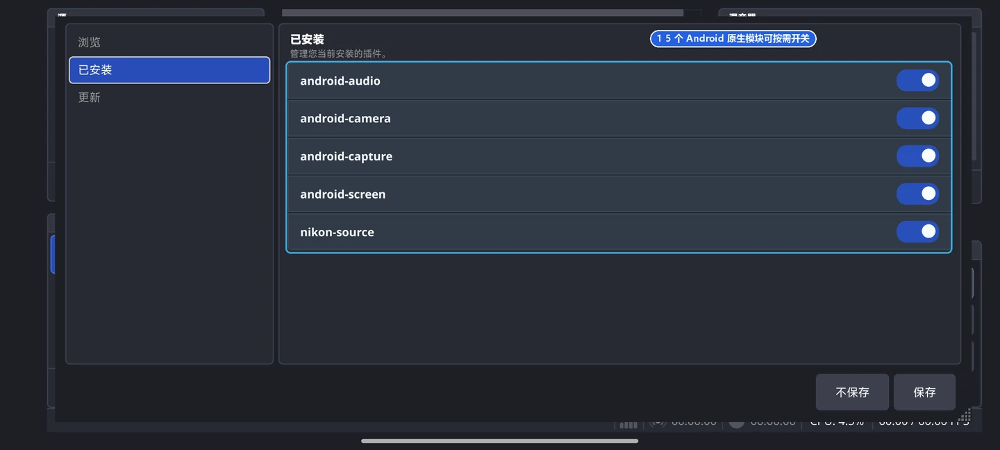

# Logs & Bug Reporting

When diagnosing crashes, black screens, or encoder failures, collect OBS's built-in logs and `adb logcat` captures, or isolate native plugins with **Plugin Manager**.

## 1. View & Export Logs Inside OBS

Open `☰` → **Help (H) → Log Files**:
* **View Current Log**: Inspect plugin loads, MediaCodec negotiations, and error traces from the current session.
* **Export Current Log / Export Last Log**: After an unexpected crash, relaunch OBS and export the **Last Log** to capture what happened right before the crash.

> [!CAUTION]
> Always inspect and remove **Stream Keys, account tokens, private LAN IPs, and personal paths** before posting logs on GitHub Issues or community chats.

## 2. Filter Subsystem Events with `adb logcat`

With USB debugging connected to a computer:

```sh
# Inspect MediaCodec hardware encoder events
adb logcat -v threadtime -d -s 'OBS-MediaCodec:*'

# Inspect screen capture, USB UVC, storage bridge, and display RHI
adb logcat -v threadtime -d -s 'OBS-screen:*' 'OBS-usb:*' 'OBS-storage:*' 'OBS-display:*'
```

## 3. Isolate Optional Plugins via Plugin Manager

Open `☰` → **Tools (T) → Plugin Manager** to toggle Android's 5 optional native capture modules independently:



* `android-audio` (AAudio Audio Input)
* `android-camera` (Built-in Camera Camera2)
* `android-capture` (USB UVC Capture)
* `android-screen` (Screen Capture MediaProjection)
* `nikon-source` (Nikon Z Series Direct USB)

If you suspect a specific module causes device-specific instability, disable it here, tap **Save**, and restart OBS to verify.

## 4. What to Include in a Bug Report

Include your device model, Android version, APK version, scene sources/resolutions, exact reproduction steps, and sanitized log excerpts (see [Contributing](../project/contributing.md)).
