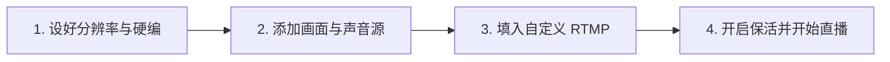
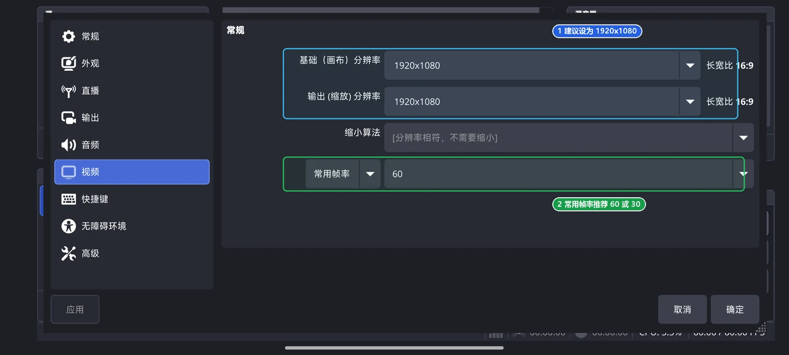
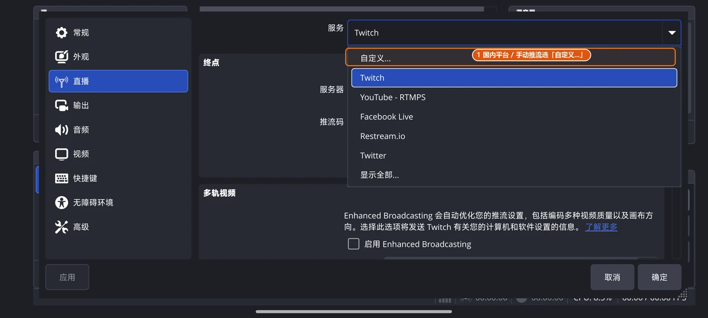

# 第一次直播

只需 5 分钟，按下面 4 个步骤就能完成首次开播（或测试录屏）。

## 第 1 步：配置视频与编码器

1. 点击右下角 **设置 → 视频**：
   * **基础（画布）分辨率** 与 **输出（缩放）分辨率**：建议设为 `1920x1080`（网络一般或怕发热可选 `1280x720`）。
   * **常用帧率**：游戏选 `60`，聊天或户外弱网选 `30`。
2. 切换到 **设置 → 输出**（默认「简单」模式）：
   * **视频编码器**：优先选择 **`Android MediaCodec H.264`**（零拷贝硬件编码，省电流畅）。
   * **视频码率**：`1080p60` 建议 `4500–6000 Kbps`，`720p30` 建议 `2500–3500 Kbps`。
   * **音频码率**：保持 `160`。

## 第 2 步：添加来源

回到主界面，点击「源」底部的 **`+`** 按钮：
* **手游直播**：添加 **屏幕采集（MediaProjection）**（自带系统内录），再按需添加 **AAudio 音频输入**（耳机麦克风）与 **安卓浏览器**（透明弹幕机）。
* **露脸口播**：添加 **内置摄像头（Camera2）** 与 **AAudio 音频输入**。
* **外接采集卡**：添加 **UVC 摄像头（Android USB）**。

在预览画面中拖动调整位置，并查看右侧「混音器」，确保说话或游戏时绿色/黄色音量条正常跳动。

## 第 3 步：填写推流服务器与推流码

1. 打开 **设置 → 直播**。
2. 将 **服务** 选为 **`自定义...`**。
3. 把直播平台主播中心提供的 **服务器地址**（如 `rtmp://...`）与 **推流码** 粘贴进去，点 **确定** 保存。

## 第 4 步：开始直播与保活

1. 确保已授予 OBS **通知权限**，并在手机系统设置里关闭对 OBS 的省电限制（详见 [后台保活与防杀指南](../streaming-and-recording/background-keepalive.md)）。
2. 点击控制区的 **开始直播**，底部状态栏出现绿色信号格且推流计时开始递增，即说明开播成功！
