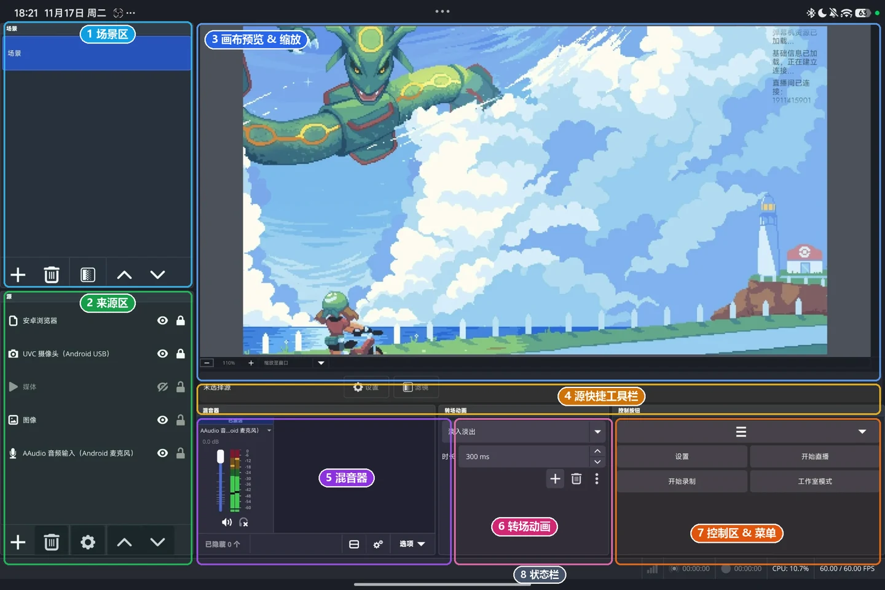
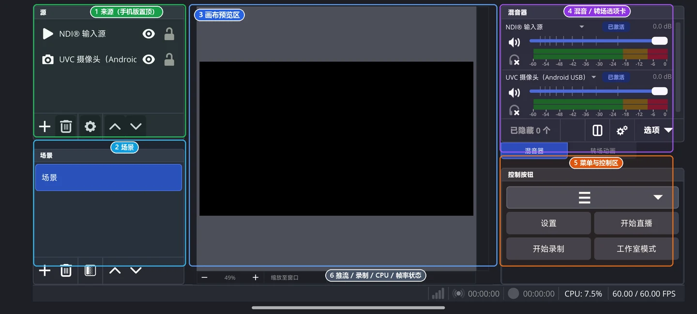
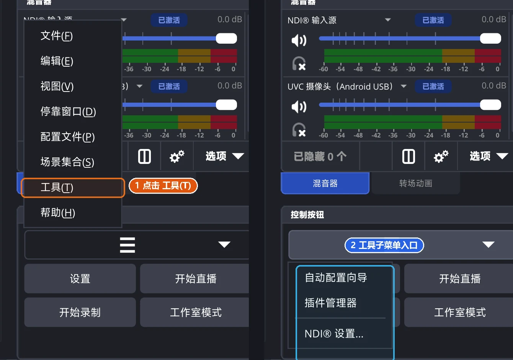

# 界面导览与触控操作

OBS for Android 会根据可用逻辑尺寸自动切换两套界面形态：当逻辑宽度 `< 952` 或高度 `< 552` 时自动进入**手机紧凑模式**，空间充裕时展开为**平板完整工作区**。

## 1. 平板完整工作区

1. **场景区**：切换与编排不同画面方案（如「游戏画面」「休息中」「纯摄像头」）。
2. **来源区**：管理当前场景内的图层，列表**自上而下**覆盖（排在上方会遮住下方）。右侧「眼睛」控制显隐，「锁」防止误触拖动。
3. **画布预览 & 缩放**：实时查看合成效果，底部 `- / +` 可缩放画布细节（推荐日常保持「缩放至窗口」）。
4. **源快捷工具栏**：选中某个来源后，可直接点击 **设置**、**滤镜**；可交互来源还会出现 **交互** 按钮。
5. **混音器**：实时显示音量电平、静音按钮与高级音频设置入口。
6. **转场动画**：设置切换场景时的过渡效果与时长（默认「淡入淡出 300 ms」）。
7. **控制区 & `☰` 菜单**：集中了 `☰` 主菜单、**设置**、**开始直播**、**开始录制**、**工作室模式**；当场景内包含内置摄像头时，还会自动多出 **前后置** 快捷按钮。
8. **状态栏**：实时显示推流/录制计时、CPU 占用与帧率。

## 2. 手机横屏紧凑模式

手机端会自动做几项贴合小屏的调整：
* **「源」上移、「场景」下移**：高频使用的开关图层、调属性放到左上角顺手位置。
* **「混音器」与「转场动画」合并为选项卡**：底部标签一键切换，为中间画布留出最大视野。
* **未选中来源时自动收起快捷工具栏**：点击来源后自动弹出，不点时让出整行预览高度。
* **控制按钮双列排布**：减少纵向挤压，支持在分屏、自由小窗（Freeform）下动态适配不溢出。

## 3. 菜单入口：`☰` 汉堡菜单

原本桌面版顶部的菜单栏全部收纳在控制区的 `☰` 按钮内：

* **文件(F)**：查看录制目录、退出应用等。
* **配置文件(P) / 场景集合(S)**：新建、切换或通过系统文件选择器导入/导出备份。
* **工具(T)**：打开 **自动配置向导**、**插件管理器** 与 **NDI® 设置…**。
* **帮助(H)**：查看或导出 **日志文件**、**检查更新**、关于信息。

## 4. 触控操作小技巧

* **拖拽与锁定**：单指点击预览画布中的元素即可移动或拖角缩放；排版定稿后点亮来源列表右侧的「小锁」防止误碰。
* **防息屏**：建议在 **设置 → 常规 → 输出** 中勾选 **直播、录屏时保持屏幕常亮（不自动息屏）**。
