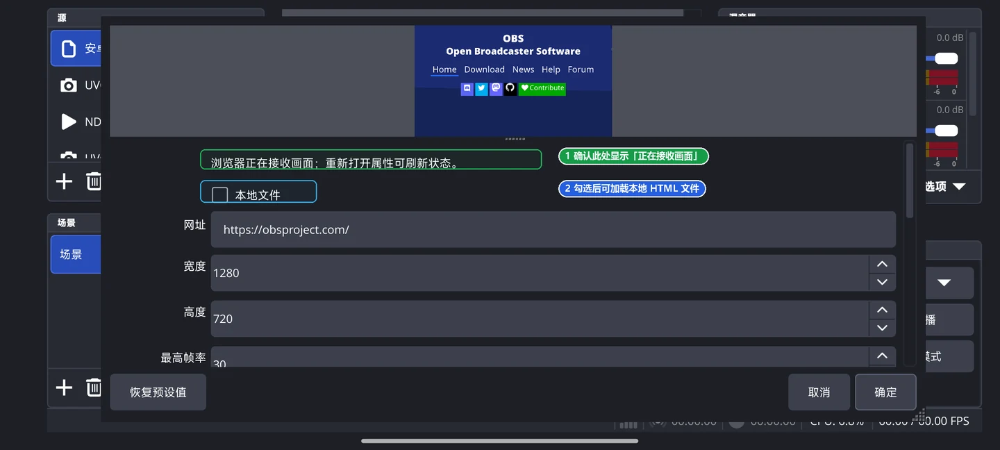

# 安卓浏览器与弹幕叠加

**安卓浏览器**基于 Android 系统 WebView，通过独立虚拟显示屏和 `AHardwareBuffer` 零拷贝通道将网页渲染为 GPU 纹理，非常适合用来挂**透明弹幕机、礼物播报、粉丝数挂件或本地 HTML 动效**。

## 1. 常用配置项

* **在线网址 vs 本地文件**：取消勾选「本地文件」可直接输入弹幕机或活动页面 URL；勾选「本地文件」后可从存储中选择 `.html` / `.xhtml` 挂件。顶部缩略图下方显示 **「浏览器正在接收画面」** 即代表运行正常。
* **宽度 / 高度 / 最高帧率**：建议按挂件实际排版尺寸设置（例如 `1280×720` 或竖条弹幕区 `480×800`）；弹幕或时钟类挂件将 **最高帧率** 设为 `30` 即可，更加省电。
* **透明背景（重点）**：
  * 勾选 **透明背景** 后，OBS 会改用 `ImageReader (RGBA_8888)` + `EGLImage` 直接采样透明通道，无需绿色抠像即可把网页上的文字/动画直接透出下方画面。
  * 如果网页本身设置了纯色背景（比如白底），需要在 **自定义 CSS** 中补上一句 `body { background-color: transparent !important; }`。
* **透明度处理**：若透明文字边缘出现黑边或半透明发暗，可切换 **兼容（默认）** / **保留 Alpha（直通输入）** / **保留 Alpha（预乘输入）** 观察边缘效果。

## 2. 音频控制与交互操作

* **通过 OBS 控制音频**：勾选后网页会自动重载，并将其播放的声音路由进 OBS 混音器，方便单独调节音量或添加滤镜。注意：如果网页内的音视频资源来自第三方跨域域名，需要远端服务器返回 CORS 跨域允许头，否则 WebView 无法截取该音轨。
* **交互点击网页**：在主界面选中安卓浏览器源后，点击快捷工具栏上的 **交互** 按钮，即可直接用单指在弹窗中滚动页面、点击登录或触发网页按钮（目前暂不支持多指缩放手势）。
