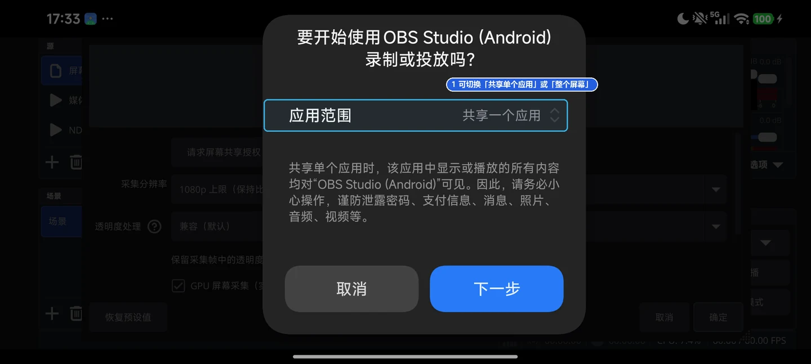
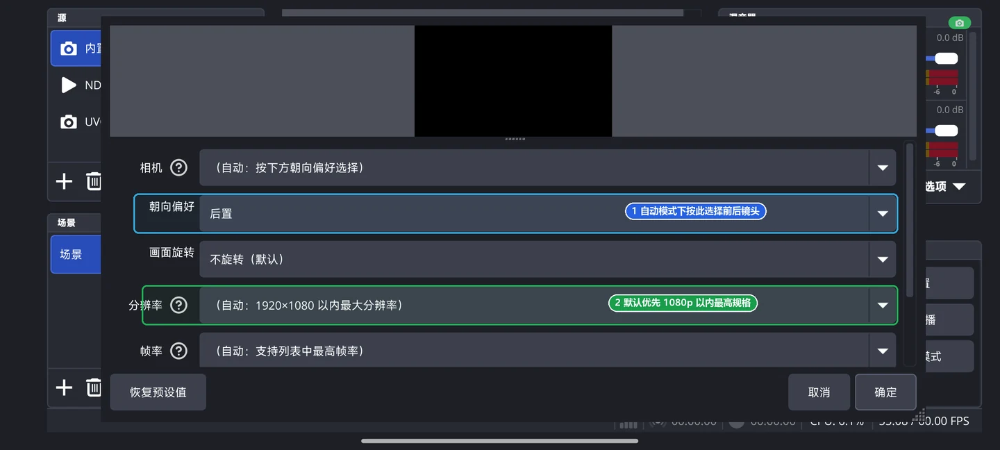

# 摄像头与屏幕采集

本页介绍移动端最常用的三种画面采集方式：**屏幕采集（MediaProjection）**、**内置摄像头（Camera2）** 与 **Nikon Webcam（Z 系列）**。

## 1. 屏幕采集（MediaProjection）

适合手游直播、App 演示录制，同时能直接内录手机系统声音。

* **单应用 vs 整个屏幕**：在 Android 14 及以上系统，系统弹窗顶部可切换「**共享单个应用**」或「**共享整个屏幕**」。选择共享单个应用时，切回桌面或下拉通知栏都不会被观众看到；目标应用旋转横竖屏或变更窗口大小时，OBS 会自动跟着调整尺寸。
* **采集分辨率**：建议保持 **`1080p 上限（保持比例，减少内存带宽）`**。除非确认需要超清细节，否则不建议在高分屏（2K/1.5K）上开「屏幕原生分辨率」，以免 GPU 带宽暴涨。
* **GPU 屏幕采集（实验）**：默认开启，使用 `SurfaceTexture` / OES 零拷贝直入渲染管线；仅在极个别机型出现花屏或黑屏时取消勾选，手动回退为 CPU 采集。
* **透明度处理**：普通屏幕保持 **兼容（默认）**；若捕获的是带透明通道的悬浮窗/动捕形象，可按需选择 **保留 Alpha（直通）** 或 **保留 Alpha（预乘输入）**。
* **系统内录音频**：屏幕采集会自动附加系统音频输出，在属性页底部可实时看到采样格式和峰值电平。

## 2. 内置摄像头（Camera2）

* **相机与朝向偏好**：保持相机为「自动」，在 **朝向偏好** 选择 **前置** 或 **后置** 即可。
* **主界面一键翻面**：只要当前场景顶层有内置摄像头源，控制区就会亮起一个 **前后置** 快捷按钮，点一下就能秒切前置自拍 / 后置拍摄。
* **分辨率与帧率**：「自动」模式会优先选用 `1920×1080` 以内的最高可用规格和最高峰值帧率（同等上限优先固定帧率）；暗光环境掉帧时，可手动改为 `1280×720` 或固定 `30 fps`。
* **画面旋转 & 色彩矩阵**：方向不对可用 **画面旋转**（90°/180°/270°）修正；如发现画面明显偏色，可对比切换 `Rec. 709` 与 `Rec. 601`。
* **后台策略**：受 Android 相机占用限制，App 退后台时会自动暂停并释放镜头，切回前台时自动恢复。

## 3. Nikon Webcam（Z 系列相机直连）

如果你拥有尼康 Z 系列无反相机，无需 HDMI 采集卡，用一根 USB 线即可直连实时取景：

1. 将相机 USB 模式设为 **MTP/PTP** 并用数据线连到手机。
2. 添加 **Nikon Webcam（Z 系列）**，点 **申请 USB 授权** 并选择相机。
3. **Live View 分辨率**支持 `QVGA 320×240`、`VGA 640×480`、`XGA 1024×768（默认上限）`，**JPEG 质量（0–5）** 可在传输带宽和画质间调节。
4. 若提示「相机禁止 Live View」，请确认相机没有停留在菜单/回放界面，且电量充足、未过热或未在机内录像。
