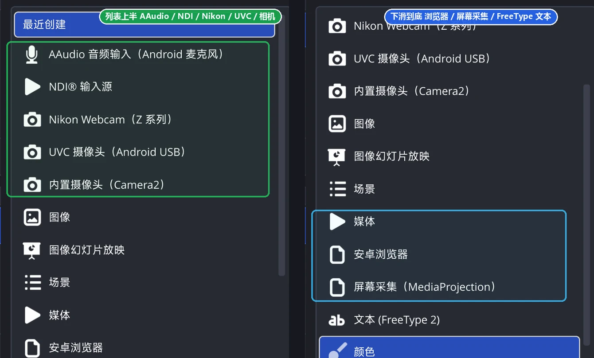
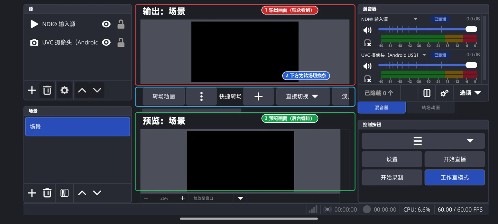

# 场景管理

OBS 通过「**场景（Scenes）**」和「**来源（Sources）**」组织画面：你可以提前准备多个场景（例如「游戏主视角」「露脸休息」「片头倒计时」），开播时一键切换。

## 1. 添加与编排来源

点击「源」底部的 `+` 按钮即可添加内容。列表遵循**从上到下层叠覆盖**原则：
* 背景图、全屏游戏采集放在最下方；
* 画中画摄像头、直播间标题（FreeType 2 文本）、透明弹幕机（安卓浏览器）放在上方。
* 用右侧的「眼睛」图标可临时隐藏某个图层，点击「小锁」图标可锁定位置避免直播中误触拖动。

## 2. 工作室模式（预览后切换）

点击控制区 **工作室模式**，界面会变为「输出（上方） + 预览（下方）」双画面：

* **上面「输出」**：当前正在直播或录制的实时画面。
* **下面「预览」**：后台预编排区。你可以先在下方的预览画布调整好位置、开关图层，确认无误后再点击中间的转场按钮或拖动推子切到线上。

## 3. 转场动画、滤镜与场景集合

* **转场动画**：支持淡入淡出（默认 300 ms）、滑动、划像、亮度遮罩及透明视频转场（Stinger）。手机紧凑模式下位于右上角「转场动画」选项卡。
* **视频滤镜**：选中源后点快捷工具栏 **滤镜**，可添加 **色彩校正**、**裁剪/填充**、**缩放/宽高比**、**色度键（绿幕抠像）** 等效果。
* **场景集合导出/导入**：点击 `☰` → **场景集合(S)**（或 **配置文件(P)**），支持通过系统文件选择器导出备份到共享目录，换机或重装后可直接导入恢复。
