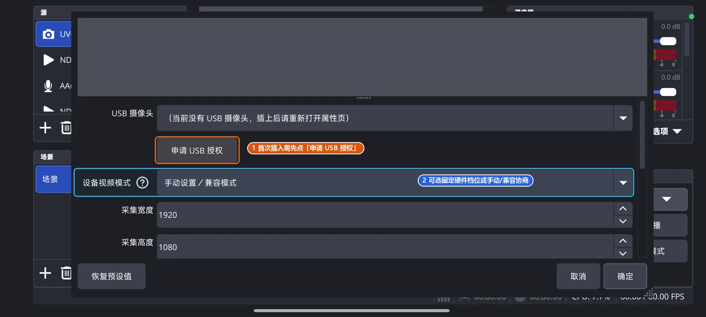

# USB/UVC 采集卡

通过 **UVC 摄像头（Android USB）**，可以把 Switch、PS5、微单/单反相机或电脑的 HDMI 画面经由 USB 采集卡送入手机/平板，也支持外接 USB 摄像头。

## 1. 连接与 USB 授权

1. 建议使用带 **PD 供电** 的 USB 3.0 扩展坞或短直连线接入采集卡，避免长期直播手机电量耗尽或供电不足掉线。
2. 添加 **UVC 摄像头（Android USB）** 后打开属性页，若设备下拉显示 `（未授权）`，点击 **申请 USB 授权** 并允许系统弹窗。

## 2. 采集引擎、模式与格式设置

* **采集引擎（双后端）**：
  * **内置原生引擎（默认）**：基于 `libusb` 的自定义低延迟 ISO / Bulk 采集管线，支持全套色域、YUV 锁定、最低延迟与断流看门狗，并对索尼 A7M4 等大载荷 Bulk 相机做了兼容优化。
  * **libuvc 兼容引擎**：内置 `libuvc 0.0.9` 备用后端。当少数相机或采集卡在默认引擎下无法正常协商或出图时，可切换到该引擎尝试，切换后会即时重新探测设备档位。
* **设备视频模式**：
  * **具体硬件档位**（如 `MJPEG 1920×1080 · 60 帧/秒`）：直接锁定采集卡上报的硬件档位，最稳定。
  * **手动设置 / 兼容模式**：由 OBS 按你填写的宽高、帧率和视频格式自动协商兼容档位。
* **视频格式怎么选**：
  * **`MJPEG`**：对 USB 带宽要求低，USB 2.0 线材也能跑 `1080p60`，兼容性最好。
  * **`YUYV` / `UYVY` / `NV12` / `RGB24` / `BGR24`**：未压缩原生画面，细节更锐利、无 JPEG 压缩块，但需要稳定的 **USB 3.0** 连接。
* **低延迟与锁定选项**：
  * **锁定所选 YUV 档位（禁止自动回退）**：使用 `YUYV`、`UYVY`、`NV12` 或 `P010` 时开启，可阻止系统自动降级回 MJPEG，并启用 USB 带宽预检。
  * **最低延迟（优先最新帧）**：接主机玩动作/音游时推荐勾选（需先开启锁定 YUV 档位），会丢弃队列中的积压帧以换取最低画面延迟。

## 3. 采集卡伴音与自动重连

* **音频输入**：默认 **自动匹配** 会按 USB 路径或 VID:PID 自动绑定采集卡自带的 USB 声卡（需要已授予麦克风权限）。如果没匹配到，可以在下拉框中手动选择对应设备，或改用「系统默认」。
* **断流看门狗**：内置了与 `libusb` 事件线程解耦的环形缓冲接收管线和看门狗——当发生接触不良、热插拔或端点卡死时，OBS 会自动清管道并尝试重连恢复。

> [!NOTE]
> 更多关于不同采集卡的线材、色域和兼容性排查，请查看 [采集卡兼容性](../compatibility/capture-card-compatibility.md)。
