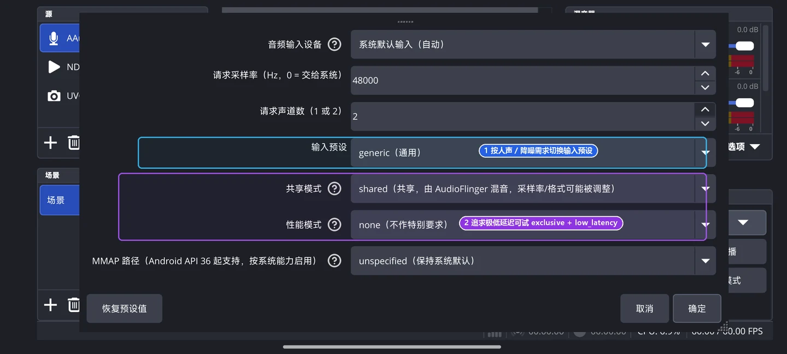

# 音频设置

OBS for Android 使用原生低延迟 **AAudio** 引擎采集麦克风、耳机和 USB 声卡音频，编码输出默认采用 FFmpeg AAC（`ffmpeg_aac`）。

## 1. 全局音频设置

打开 **设置 → 音频**：
* **采样率**：保持默认的 **`48 kHz`**。
* **声道**：选择 **`立体声`**。
* **全局音频设备**：建议保留「已禁用」，需要哪路麦或伴音直接在当前场景中以来源方式添加，切场景时互不干扰。

## 2. 添加 AAudio 音频输入（Android 麦克风）

* **音频输入设备**：
  * 日常选 **系统默认输入（自动）** 即可，插上有线耳机或蓝牙麦时由系统切换。
  * 如果接入了多台 USB 声卡/麦，可手动指定设备。即使重新插拔后 Android 分配了新的设备 ID，OBS 也会尝试按产品名称自动重新匹配。
* **输入预设**：
  * `generic（通用）`：多数情况默认即可。
  * `voice_communication（通话）`：带系统回声消除，适合连麦语音或外放环境。
  * `unprocessed（不做任何处理）`：外接专业 USB 声卡/电容麦时推荐，防止系统自带降噪把人声压瘪。
* **共享模式与性能模式**：如果外接设备支持，可尝试 **`exclusive（独占）` + `low_latency（优先低延迟）`** 以压低延迟；若设备 HAL 不支持，插件会自动回退到 `shared（共享）` 保证正常出声。
* **MMAP 路径**：仅在 **Android API 36+** 且底层 HAL 支持时生效，低版本系统会自动忽略并走默认路径。

## 3. 混音器与降噪滤镜

在主界面 **混音器** 中，可以独立调整每条来源的音量推子，尽量让说话或游戏峰值保持在绿色到黄色区域（`-18 dB` 至 `-6 dB`），避免顶到红色 `-0 dB` 爆音。

点击音源右侧的齿轮图标 → **滤镜**，可叠加内置音频滤镜：
* **噪声抑制**：推荐选 `RNNoise`（AI 降噪效果好）或 `Speex`（极低 CPU 占用），过滤风扇与环境底噪。
* **增益 / 压缩器**：人声太轻可加增益，大喊时防爆音可加压缩器。
* **高级音频属性**：可为不同来源勾选 **监听（仅监听/监听并输出）**，或分配到多条独立音轨（如音轨 1 放混音直播、音轨 2 单独录纯人声）。
