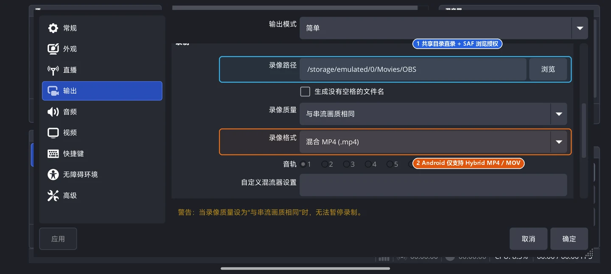

# 本地录制

在 Android 端，OBS 通过 **MediaStore / SAF（存储访问框架）** 直接操作底层可定位的文件描述符（File Descriptor）写入录像，**无需申请「所有文件访问权限」**，也**不在私有目录中转二次拷贝**。

## 1. 录制路径配置

* **默认目录**：`/storage/emulated/0/Movies/OBS`（对应手机文件管理中的 `Movies/OBS` 文件夹），录制完毕后系统相册即可直接识别成片。
* **更改保存目录（SAF 授权）**：如果想存到 `Download/obs` 或外置存储卡，点击录像路径旁的 **浏览** 按钮，在系统文件选择器中选定目标目录并点「使用此文件夹 / 允许访问」即可持久化授权。

## 2. 录制格式说明（为什么只有混合 MP4 / MOV）

在 **设置 → 输出 → 录制 → 录像格式** 下拉框中，Android 版仅保留两项原生支持的封装格式：
* **`混合 MP4 (.mp4)`**（首选推荐）
* **`混合 MOV (.mov)`**

> [!NOTE]
> 桌面端常见的 `mkv`、`flv`、`ts` 与 `自定义输出 (FFmpeg)` 在桌面版内部依赖独立的 `ffmpeg-mux` 伴生可执行进程；由于 Android 安全沙箱限制应用 `fork+exec` 拉起子进程，这些格式在 Android 端已从界面隐藏。而 **混合 MP4 / MOV** 由 `obs-outputs` 原生写入器在进程内直接完成封装，兼具 MP4 通用性与**防断电/闪退坏档**能力——即使录到一半没电关机，已写入的片段依然可正常播放。

## 3. 录像质量与暂停录制

* **与串流画质相同**：推流的同时做本地备份，最省性能（只跑一次编码），但**不支持暂停录制**。
* **高质量, 中等文件大小**（MediaCodec 下为 `8 Mbps CBR`）或 **近似无损的质量, 大文件大小**（`12 Mbps CBR`）：适合单纯高质量录屏，支持录制途中随时点击暂停/继续。
* **边播边录**：在 **设置 → 常规 → 输出** 中可勾选 **直播时自动录制**。
