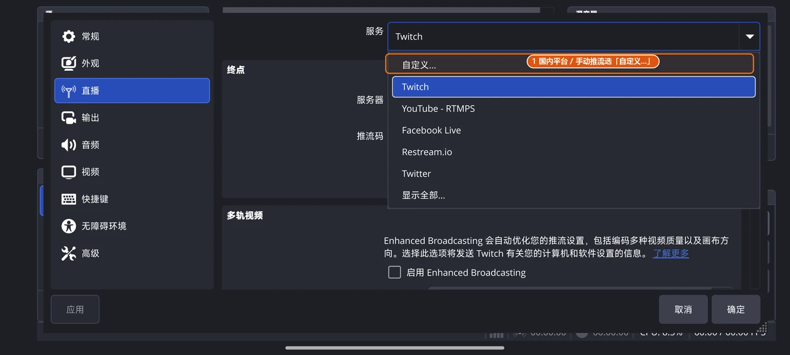

# RTMP / SRT 推流与协议说明

在 Android 端，**推流（往外发）** 与 **拉流（往里收）** 对协议的支持范围不同，配置前请先了解清楚：

| 场景 | 支持协议 | 说明 |
| --- | --- | --- |
| **直播推流（设置 → 直播）** | `RTMP` / `RTMPS`（以及局域网 `NDI®`） | 通过原生 `obs-outputs` + MbedTLS 推送；支持在高级输出模式下推 H.264 / HEVC / AV1 over RTMP。 |
| **媒体拉流（添加「媒体」源）** | `SRT`、`RIST`、`RTSP(S)`、`RTMP(S)`、`HLS`、`DASH`、`HTTP(S)` | 基于内置 FFmpeg（含 `srt-1.5.4`、`librist` 与 `mbedtls`），详见 [网络媒体源](../scenes-and-sources/network-media-source.md)。 |

> [!IMPORTANT]
> 由于 Android 平台不允许拉起 `obs-ffmpeg-mux` 伴生子进程，**当前版本的「直播推流」暂不支持向 `srt://` 或 `rist://` 服务器推流**（在设置里虽然可填写 `srt://` 开头的自定义 URL，但启动输出会失败）。如果你需要向电脑导播台低延迟无线推流，推荐改用 [NDI® 主程序输出](../advanced/ndi-and-recipes.md) 或局域网 RTMP 服务。

## 1. 配置自定义 RTMP / RTMPS 推流

因为 Twitch / YouTube OAuth 一键登录已禁用，所有平台均统一使用手动填写模式：

1. 打开 **设置 → 直播**。
2. 在 **服务** 下拉菜单选择 **`自定义...`**。
3. 从你的直播平台（B站、抖音、虎牙、斗鱼、YouTube Studio、自建 SRS/Nginx-RTMP 等）复制参数：
   * **服务器**：填写 `rtmp://...` 或 `rtmps://...` 地址。
   * **推流码**：粘贴平台分配的密钥（若平台提供的是完整单行 URL，可按最后一个 `/` 拆分为服务器和推流码）。
4. 若服务器需要鉴权，可勾选 **使用身份认证** 并填写用户名与密码。

## 2. 弱网断线重连与动态码率

建议在 **设置 → 高级 → 网络** 中检查两项实用保护：
* **自动重连**：默认启用（可调重试间隔与最大次数），Wi-Fi 切 5G 或进电梯短暂断网后自动恢复推流。
* **动态变更比特率**：在移动网络户外直播时建议勾选。检测到发送队列积压时会自动临时下调视频码率，优先保证不掉线、不卡成幻灯片。
