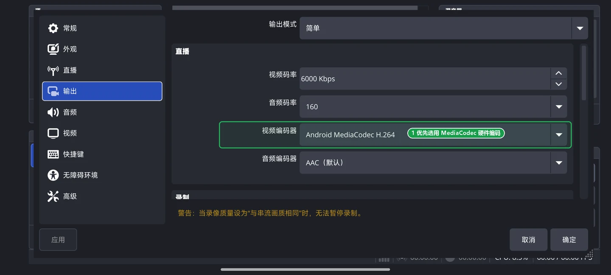

# 视频编码器

打开 **设置 → 输出**，可以在「简单」或「高级」模式下选择推流和录制使用的视频编码器。

## 1. 编码器选型对照表

OBS for Android 优先排在列表顶部的是 **MediaCodec 硬件编码器**，其次是内置软件编码器：

| 编码器名称 | 实现方式 | 适用场景 | 建议与备注 |
| --- | --- | --- | --- |
| **Android MediaCodec H.264** | 硬件编码（首选） | **直播推流 & 常规录制** | 几乎所有平台、浏览器和剪辑软件都能直接解码，兼容性最好。 |
| **Android MediaCodec HEVC (H.265)** | 硬件编码 | **本地高清录制** / 支持 H.265 推流的平台 | 同等码率下比 H.264 画质更清晰，文件更省空间。 |
| **Android MediaCodec HEVC Main10** | 10-bit 硬件编码 | **Android 13+ 10-bit HDR** | 需先在 **高级 → 视频** 启用 `Rec. 2100` 且设备硬件支持，否则不可选。 |
| **Android MediaCodec AV1** | 硬件编码 | 推流 & Hybrid MP4 录制 | 仅部分新款旗舰芯片提供硬件 AV1 编码器。 |
| **Android MediaCodec VP9** | 硬件编码 | Hybrid MP4 本地录制 | 部分机型可用，主要用于本地高效压缩存档。 |
| **软件 (x264)** | CPU 软编 | 硬件编码不可用时的兜底 | 功耗和发热显著高于 MediaCodec，建议配合 `ultrafast` 预设使用。 |
| **Software HEVC (x265)** / **Software AV1 (AOM)** | CPU 软编 | 无硬件 Main10 时的 10-bit (`I010`) 软编 | 负载较高，适合低分辨率或短时长 HDR 录制验证。 |

## 2. 推荐码率参考（CBR）

| 分辨率与帧率 | 直播推流建议码率 | 本地录制建议码率 |
| --- | --- | --- |
| **720p 30 FPS** | `2500 – 3500 Kbps` | `4000 – 6000 Kbps` |
| **1080p 30 FPS** | `3500 – 4500 Kbps` | `6000 – 8000 Kbps` |
| **1080p 60 FPS** | `4500 – 6000 Kbps` | `8000 – 12000 Kbps` |

> [!TIP]
> 在「简单」输出模式下，如果录像质量选「**高质量, 中等文件大小**」或「**近似无损的质量, 大文件大小**」且录制编码器为 MediaCodec，界面上会直接标出对应使用的固定码率（分别为 `8 Mbps` 和 `12 Mbps`）。
