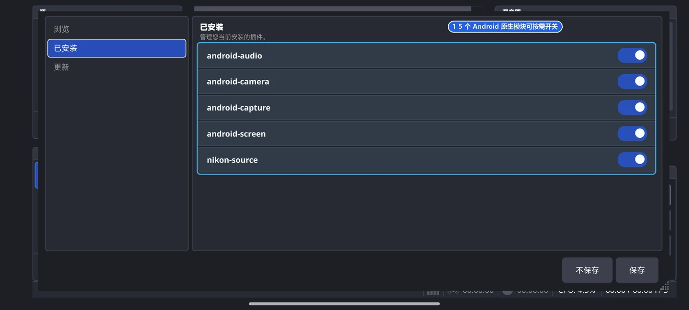

# 日志收集与问题反馈

遇到无法解决的闪退、黑屏或编码异常时，可以通过应用内日志与 `adb logcat` 快速定位问题，也可以用来排查可选插件模块。

## 1. 在应用内查看与导出日志

在主界面控制区点击 `☰` → **帮助(H) → 日志文件**：
* **查看当前日志**：直接浏览本次启动后的详细输出（包含插件加载、采集协商与报错栈）。
* **导出当前日志 / 导出上一次日志**：如果刚发生过闪退重启，重启后选择「导出上一次日志」就能保存闪退前的完整记录。

> [!CAUTION]
> 向 GitHub Issues 或社区群分享日志前，请务必检查并删除其中的**推流码（Stream Key）、个人账号 Token、内网 IP 与隐私路径**。

## 2. 使用 ADB Logcat 排查硬编与底层事件

连接电脑后，可以按 Tag 过滤关键日志：

```sh
# 查 MediaCodec 硬件编码状态
adb logcat -v threadtime -d -s 'OBS-MediaCodec:*'

# 查屏幕采集、USB UVC、存储桥与界面状态
adb logcat -v threadtime -d -s 'OBS-screen:*' 'OBS-usb:*' 'OBS-storage:*' 'OBS-display:*'
```

## 3. 通过插件管理器排查可选模块

打开 `☰` → **工具(T) → 插件管理器**，可以看到 5 个可独立启停的 Android 原生采集模块：



* `android-audio`（AAudio 音频输入）
* `android-camera`（内置摄像头 Camera2）
* `android-capture`（USB UVC 采集卡）
* `android-screen`（屏幕采集 MediaProjection）
* `nikon-source`（Nikon Z 系列相机直连）

如果怀疑某个特定硬件采集模块引起冲突，可在这里先关闭对应开关、点 **保存** 并重启 OBS 验证。

## 4. 提交 Bug 时建议附带的信息

请附上设备型号、Android 系统版本、APK 版本号、场景来源配置、复现步骤，以及脱敏后的 OBS 日志片段（详见 [参与贡献](../project/contributing.md)）。
